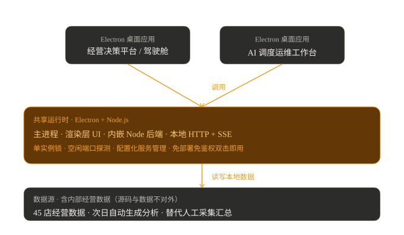

# Swan Electron Suite

### 跑在 45 店生产环境的 Electron 桌面套件（经营决策平台 + 调度运维工作台）

> 一套自研的 Electron 桌面套件，真实运行于某连锁烘焙品牌 45+ 家门店的生产环境：把总部经营数据与 AI 运维调度收进两个"双击即用"的桌面应用，替代原有人工采集、汇总、制表、打印传阅的全流程。

> 📌 **技术关键词**：Electron · 进程内嵌后端 · 单实例锁 · 空闲端口探测 · 本地 HTTP + SSE · 配置化服务管理 · 数据闭环

---

## 包含两个应用

**经营决策平台（驾驶舱）**：经营总览 KPI → AI 经营分析 → 异常雷达 / 30 日趋势；覆盖 45+ 家门店全量数据，服务高层与营运部；次日自动生成分析，替代原来的人工采集、汇总、制表、打印传阅。

**AI 调度运维工作台**：系统健康 + 自动化清单 + 服务一键启停；把一堆本地常驻服务的启停、健康检查、配置做成一个控制台。

## 架构

两个应用共享一套 Electron 运行时（主进程 / 渲染层 / 内嵌 Node 后端），通过单实例锁与空闲端口探测保证稳定，读写本地经营数据：

## 核心设计决策

每个决策都对应一个真实生产约束，不是纸上谈兵。详见 [docs/design-decisions.md](docs/design-decisions.md)：

- 用 **Electron 桌面端**而不是 Web 服务——单机常驻、免部署、免鉴权、双击即用
- **单实例锁 + 空闲端口探测**——内嵌后端不写死端口、不重复启动
- **进程内嵌 Node 后端**——没有运维和服务器预算，一个安装包全带走
- **次日自动生成分析**——替代人工采集→汇总→制表→打印全流程
- **黑金主题 + 配置化服务管理**——驾驶舱专业沉稳，运维台一键管控

## 脱敏截图

关键界面截图（数据打码）见 [screenshots/](screenshots/)。

## 诚实边界

生产实现含品牌内部经营数据与私有服务配置，**源码与数据不对外开源**。本仓库公开架构、设计决策与脱敏演示，供技术交流。

## 体系定位

本仓库是 [ai-native-team](https://github.com/Babymrbbbb/ai-native-team)「AI 原生组织 OS」体系的**交付层**组件——体系跑出来的业务结果，最终落在本套件的两个 Electron 桌面应用里，交付给一线每天使用。

> 接入 AI（[sensenova-gateway](https://github.com/Babymrbbbb/sensenova-gateway)）→ 用好 AI（[prompt-craft](https://github.com/Babymrbbbb/prompt-craft)）→ LLM×RAG 知识库（[llm-wiki](https://github.com/Babymrbbbb/llm-wiki)）→ 组织 AI 落地（[ai-native-team](https://github.com/Babymrbbbb/ai-native-team)）→ 交付业务结果（本仓库：经营决策平台 / 调度运维工作台）

相关项目：旗舰 [ai-native-team](https://github.com/Babymrbbbb/ai-native-team) · 模型层 [sensenova-gateway](https://github.com/Babymrbbbb/sensenova-gateway) · 方法层 [prompt-craft](https://github.com/Babymrbbbb/prompt-craft) · 知识层 [llm-wiki](https://github.com/Babymrbbbb/llm-wiki) · 编排对照 [langgraph-agent-demo](https://github.com/Babymrbbbb/langgraph-agent-demo)

## License

MIT
